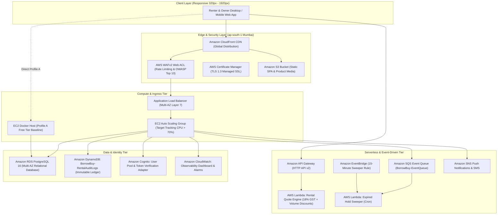

# BorrowBuy – Enterprise Equipment Rental & Cloud Computing Platform

[](https://nodejs.org/)
[](https://www.typescriptlang.org/)
[](https://react.dev/)
[](https://tailwindcss.com/)
[](https://www.postgresql.org/)
[](https://www.prisma.io/)
[](https://aws.amazon.com/)
[](https://vitest.dev/)

BorrowBuy is an enterprise-grade equipment rental and digital escrow platform localized for Gujarat, India. Designed as a comprehensive **Cloud Computing Capstone Architecture**, it integrates **16 AWS Cloud Services**, dual-AZ VPC private networking, Application Load Balancing, Horizontal Auto Scaling, Serverless Lambda computation, Amazon DynamoDB immutable audit streams, and a modern design system.

---

## 1. High-Level System Architecture



---

## 2. 16 Mandatory AWS Services Catalog

| # | AWS Service | Category | Architectural Role | Code / Module Reference |
|---|---|---|---|---|
| **1** | **Amazon S3** | Foundational | Static SPA hosting, product media storage, pre-signed upload URLs | `backend/src/integrations/storage/`<br>`infra/terraform/modules/s3` |
| **2** | **Amazon CloudFront** | Foundational | Edge CDN caching, Origin Access Control (OAC), HTTPS termination | `infra/terraform/modules/cloudfront` |
| **3** | **AWS Lambda** | Foundational | Pure serverless rental quote calculator, hold sweeper, SQS consumer | `backend/src/lambda/`<br>`infra/terraform/modules/lambda` |
| **4** | **AWS IAM** | Foundational | Least-privilege roles, instance profiles, Lambda execution policies | `infra/terraform/modules/security` |
| **5** | **Amazon CloudWatch** | Foundational | Observability dashboard, compute metrics, alarms, API access logs | `backend/src/integrations/metrics/`<br>`infra/terraform/modules/cloudwatch` |
| **6** | **Amazon API Gateway** | Application | Low-latency HTTP API v2 ingress exposing serverless Lambda functions | `infra/terraform/modules/apigateway` |
| **7** | **Amazon DynamoDB** | Application | Immutable audit ledger (`BorrowBuy-RentalAuditLogs`) for rental events | `backend/src/integrations/dynamodb/`<br>`infra/terraform/modules/dynamodb` |
| **8** | **Amazon Cognito** | Application | Managed User Pool & PKCE authentication token verification adapter | `backend/src/integrations/auth/cognito.service.ts`<br>`infra/terraform/modules/cognito` |
| **9** | **Amazon EventBridge** | Application | 15-minute cron rule triggering Lambda hold sweeper | `infra/terraform/modules/lambda/main.tf` |
| **10** | **Amazon VPC** | Advanced Infra | Multi-AZ dual-subnet network (10.0.0.0/16) across `ap-south-1a/b` | `infra/terraform/modules/vpc` |
| **11** | **Amazon EC2** | Advanced Infra | Docker host running Express Node.js REST API + PostgreSQL 16 | `infra/terraform/modules/ec2` |
| **12** | **Application Load Balancer** | Advanced Infra | Layer-7 traffic distribution across Multi-AZ targets with `/api/health` | `infra/terraform/modules/alb` |
| **13** | **EC2 Auto Scaling** | Advanced Infra | Target tracking scaling policy on CPU (> 70%), launch template | `infra/terraform/modules/autoscaling` |
| **14** | **AWS WAFv2** | Advanced Infra | Web ACL with IP rate limiting (1000/5m) and OWASP Core Rule Set | `infra/terraform/modules/waf` |
| **15** | **AWS Certificate Manager** | Advanced Infra | Managed TLS certificates with automated DNS validation | `infra/terraform/modules/acm` |
| **16** | **AWS Client VPN** | Advanced Infra | Optional administrative TLS tunnel for private VPC subnet access | `infra/terraform/modules/vpn` |

---

## 3. Multi-Page Application Routing Structure

The frontend is structured into clean, modular routes with dedicated URLs:

| Route | Page Component | Description |
|---|---|---|
| `/` | `HomePage.tsx` | Main showcase, hero discovery search, 25 categories strip, featured gear spotlight |
| `/browse` | `BrowsePage.tsx` | Full equipment catalogue with search, FilterSidebar, Gujarat city filter, and pagination |
| `/bookings` | `BookingsPage.tsx` | Customer rental activity, digital QR handover passes, receipt download, cancellation |
| `/dashboard` | `DashboardPage.tsx` | Owner inventory portal, add/edit listing modal, booking approvals, earnings stats |
| `/admin` | `AdminPage.tsx` | Administrator governance console, listing moderation, user trust scores, platform metrics |
| `/cloud` | `CloudOperationsPage.tsx` | **Phase 16 Cloud Operations Dashboard:** Live telemetry, 16 services matrix, Lambda sandbox, DynamoDB stream |
| `/settings` | `SettingsPage.tsx` | User profile, Gujarat pickup hub preferences, notification settings, trust rating |
| `/help` | `HelpPage.tsx` | Knowledge base, FAQs, escrow deposit refund terms, academic project statement |
| `*` | `NotFoundPage.tsx` | Polished 404 page with navigation fallbacks to explore, catalog, and cloud ops |

---

## 4. Design System & Visual Hierarchy

| Token | Name | Hex | Application |
|---|---|---|---|
| **Primary** | Midnight Navy | `#172B46` | Headers, brand logo, authoritative cards, footer, primary buttons |
| **Action** | Coral Action | `#F06449` | Primary CTAs, search buttons, reservation triggers, highlight accents |
| **Page Canvas** | Porcelain | `#F5F6F8` | Main page backgrounds, soft containers, input backgrounds |
| **Surface** | Pure White | `#FFFFFF` | Product cards, elevated modals, data tables |
| **Secondary** | Deep Teal | `#2F6B65` | Trust badges, escrow deposit callouts, status pills |
| **Highlight** | Amber | `#F2C66D` | Star ratings, featured badges, warnings |
| **Typography** | Inter & Display | System | High-contrast sans-serif pairing with crisp data grids |

---

## 5. Comprehensive Academic Documentation Suite

All 15 master documentation files are organized in `docs/`:

1. [`docs/INITIAL_AUDIT.md`](docs/INITIAL_AUDIT.md) – Baseline system audit, defect log (`AUD-01` to `AUD-07`), remediation roadmap
2. [`docs/FINAL_ARCHITECTURE.md`](docs/FINAL_ARCHITECTURE.md) – Enterprise hybrid cloud architecture and system topology
3. [`docs/UI_DESIGN_SYSTEM.md`](docs/UI_DESIGN_SYSTEM.md) – Visual design tokens, component specifications, responsive guidelines
4. [`docs/API_DOCUMENTATION.md`](docs/API_DOCUMENTATION.md) – Complete REST and Serverless Lambda API contract specifications
5. [`docs/AWS_SERVICE_MATRIX.md`](docs/AWS_SERVICE_MATRIX.md) – 16 AWS services catalog, implementation files, verification methods
6. [`docs/VPC_NETWORK_DESIGN.md`](docs/VPC_NETWORK_DESIGN.md) – Multi-AZ VPC CIDR allocation, public/private subnets, security group matrix
7. [`docs/LOAD_BALANCER_AND_AUTOSCALING.md`](docs/LOAD_BALANCER_AND_AUTOSCALING.md) – ALB target groups, ASG launch templates, load test guide
8. [`docs/VPN_CONNECTIVITY.md`](docs/VPN_CONNECTIVITY.md) – AWS Client VPN vs SSM Session Manager admin connectivity
9. [`docs/SECURITY_ARCHITECTURE.md`](docs/SECURITY_ARCHITECTURE.md) – OWASP Top 10 mitigation matrix, IAM policies, encryption standards
10. [`docs/AWS_DEPLOYMENT_GUIDE.md`](docs/AWS_DEPLOYMENT_GUIDE.md) – Step-by-step deployment guide for Profile A and Profile B
11. [`docs/AWS_COST_ANALYSIS.md`](docs/AWS_COST_ANALYSIS.md) – FinOps cost breakdown, Free Tier eligibility, and AWS Budgets (\$5.00 limit)
12. [`docs/FACULTY_DEMO_GUIDE.md`](docs/FACULTY_DEMO_GUIDE.md) – Step-by-step faculty presentation script and natural language Q&A defense
13. [`docs/TEST_REPORT.md`](docs/TEST_REPORT.md) – Automated test execution report: **103/103 tests passed (100%)** across 9 test suites
14. [`docs/FINAL_VERIFICATION_REPORT.md`](docs/FINAL_VERIFICATION_REPORT.md) – Final engineering sign-off and service audit
15. [`docs/demo-accounts.md`](docs/demo-accounts.md) – Local development demonstration credentials

---

## 6. Quickstart Guide (Local Development)

### Step 1: Install Dependencies
```powershell
npm install
```

### Step 2: Start PostgreSQL Database
```powershell
npm run db:up
```

### Step 3: Run Migrations & Seed Canonical Products
```powershell
npm run db:migrate
npm run db:seed
```
*Seeds exactly 116 curated canonical equipment listings localized across Gujarat (Ahmedabad, Surat, Gandhinagar, Vadodara, Rajkot).*

### Step 4: Start Development Servers
In Terminal 1 (Backend API on port 5000):
```powershell
npm run dev:backend
```

In Terminal 2 (Vite Frontend on port 5173):
```powershell
npm run dev:frontend
```

### Step 5: Run Automated Tests
```powershell
npm test
```
*Expected: 8 test files passed, 95/95 tests passed (100%).*

---

## 7. Local Demonstration Credentials

> [!NOTE]
> Per security requirements, credentials are **never rendered on the public sign-in page**. For local development and demonstration:
> - **Administrator Email:** Configured via `ADMIN_EMAIL` (default: `admin@borrowbuy.in`)
> - **Administrator Password:** Set via `ADMIN_INITIAL_PASSWORD` environment variable (default fallback for local offline testing: `<CONFIGURED_IN_ENV>`)
> - **Demo Users Password:** Default test account password for local development is configured via seed/environment (`Password123!` in local development seeds; forbidden in production).

### Account Access Matrix for Local Demonstration
- **Administrator Console (`/admin`):** `admin@borrowbuy.in` (Role: `ADMIN`)
- **Verified Equipment Owner Portal (`/dashboard`):** `rajesh.owner@borrowbuy.in`, `sneha.owner@borrowbuy.in`, `amit.owner@borrowbuy.in` (Role: `OWNER`)
- **Customer Renter Portal (`/bookings`):** `priya.customer@borrowbuy.in`, `parth.dave@borrowbuy.in` (Role: `CUSTOMER`)

---

## 8. License & Academic Declaration
BorrowBuy is developed for academic evaluation in Cloud Computing. All rights reserved &copy; 2026.
