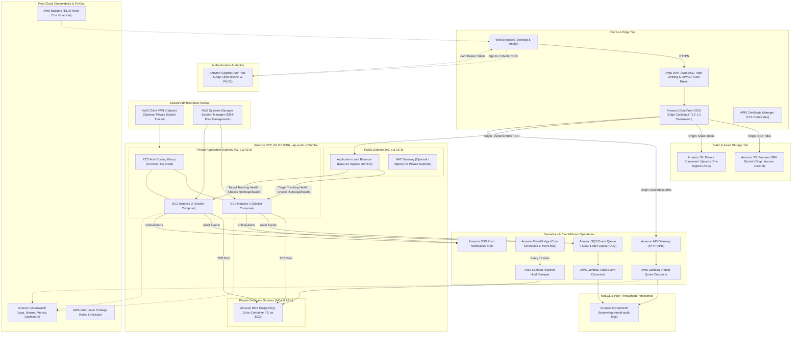

# BorrowBuy – Final Cloud Architecture & Enterprise System Design

**Project**: BorrowBuy – Product Rental and Management Platform  
**Target AWS Region**: `ap-south-1` (Asia Pacific – Mumbai)  
**Architecture Pattern**: Hybrid Containerized & Serverless Cloud Architecture  
**Author**: Principal Cloud Solutions Architect & Lead Systems Engineer  
**Compliance**: AWS Well-Architected Framework (Reliability, Security, Performance, Cost, Operational Excellence)  

---

## 1. High-Level Enterprise Architecture

BorrowBuy implements a multi-tier, hybrid cloud architecture balancing horizontal scalability, relational consistency, serverless agility, and strict cost controls:

---

## 2. The 16 Mandatory AWS Services & Their Architectural Responsibilities

| # | AWS Service | Category | Architectural Role in BorrowBuy | Primary Justification |
|:---:|---|---|---|---|
| 1 | **Amazon S3** | Foundational | Hosts frontend SPA bundle and private owner-uploaded equipment photographs. | Durable (99.999999999%), cheap, encrypted storage with pre-signed PUT URLs. |
| 2 | **Amazon CloudFront** | Foundational | Global CDN edge caching and SSL termination for India (`ap-south-1`). | Low latency (<50ms in Gujarat), Origin Access Control (OAC), and DDoS protection. |
| 3 | **AWS Lambda** | Foundational | Serverless execution for rental quotes, audit consumer, and hold sweeper. | Zero compute cost when idle; executes event-driven tasks independently of EC2. |
| 4 | **AWS IAM** | Foundational | Granular least-privilege execution roles for EC2, Lambda, and GitHub Actions OIDC. | Enforces strict role-based isolation without permanent static access keys. |
| 5 | **Amazon CloudWatch** | Foundational | Centralized logging, alarms, CPU/memory metrics, and Auto Scaling signals. | Provides end-to-end operational visibility and triggers scaling actions. |
| 6 | **Amazon API Gateway** | Application | HTTP API ingress exposing serverless Lambda endpoints (`/quote`, `/audit`). | Low-cost managed routing, automatic CORS handling, and payload validation. |
| 7 | **Amazon DynamoDB** | Application | NoSQL table storing immutable rental lifecycle audit logs and state locks. | Single-digit millisecond latency, infinite scaling, and pay-per-request pricing. |
| 8 | **Amazon Cognito** | Application | Managed authentication User Pool supporting user registration, login, and JWTs. | Enterprise auth standard supporting PKCE, MFA, and identity federation. |
| 9 | **Amazon EventBridge** | Application | Serverless scheduler and event bus triggering periodic maintenance workflows. | Replaces fragile server-side cron daemons with reliable AWS-managed scheduling. |
| 10 | **Amazon VPC** | Advanced Infra | Multi-AZ network topology with public and private subnets across 2 AZs. | Complete network isolation; keeps database and backend out of public internet. |
| 11 | **Amazon EC2** | Advanced Infra | Compute host running Node.js Express REST API and PostgreSQL in Docker. | Full control over high-performance stateful and relational operations. |
| 12 | **Application Load Balancer** | Advanced Infra | Distributes incoming HTTP/HTTPS traffic across healthy EC2 instances. | Layer 7 intelligent routing, SSL termination, and target health probing. |
| 13 | **EC2 Auto Scaling Group** | Advanced Infra | Automatically provisions or terminates EC2 instances based on load. | Ensures high availability during traffic spikes and cuts costs during idle hours. |
| 14 | **AWS WAF** | Advanced Infra | Web Application Firewall filtering SQL injection, cross-site scripting, and flood attacks. | Protects ALB and CloudFront endpoints from malicious automated traffic. |
| 15 | **AWS Certificate Manager** | Advanced Infra | Provisions and auto-renews free public SSL/TLS certificates. | Enables end-to-end HTTPS encryption across CloudFront and Load Balancer. |
| 16 | **AWS Client VPN** | Advanced Infra | Secure OpenVPN-compatible tunnel for private administrative VPC access. | Allows administrators to securely reach private subnets without public bastion hosts. |

---

## 3. Separation of Responsibilities: EC2 vs Lambda vs DynamoDB vs PostgreSQL

BorrowBuy avoids architectural redundancy by giving each compute and storage technology a distinct role:

### A. Compute Separation
- **Amazon EC2 (Stateful / Complex Relational API)**:
  - Handles the core rental booking state machine, multi-table transactions (Booking + Payment + Notification), cryptographic QR handover generation, and Prisma ORM relationships.
  - Reason: Relational integrity and low-latency database connection pooling require long-running Node.js processes.
- **AWS Lambda (Serverless / Event-Driven Operations)**:
  - `RentalQuoteCalculator`: Pure functional compute calculating daily rental rates, multi-day discounts, GST (18%), and security deposits on the fly.
  - `HoldSweeper`: Periodic cron job triggered every 15 minutes by EventBridge to sweep expired temporary reservation holds.
  - `AuditLogConsumer`: Asynchronously reads messages from SQS and records immutable events to DynamoDB.
  - Reason: These tasks are bursty, idempotent, or scheduled, making serverless cost-efficient and independent.

### B. Persistence Separation
- **PostgreSQL 16 (Relational Source of Truth)**:
  - Stores strongly consistent relational entities: `User`, `Category`, `Product`, `Booking`, `Payment`, `Review`, `Inspection`.
  - Enforces foreign key constraints and ACID transactional isolation during checkout.
- **Amazon DynamoDB (Immutable Event Sourcing & Audit Ledger)**:
  - Stores high-volume rental lifecycle telemetry (`BorrowBuy-RentalAuditLogs`):
    - Partition Key (`PK`): `RENTAL#<bookingId>`
    - Sort Key (`SK`): `EVENT#<timestamp>#<eventId>`
    - Attributes: `eventType`, `actorId`, `actorRole`, `metadata`, `ipAddress`
  - Reason: Append-only audit trails do not require relational joins and benefit from DynamoDB's zero-maintenance scaling and fast partition queries.

---

## 4. Multi-Tier Security & Zero Trust Network Topology

1. **Edge Protection**: CloudFront + AWS WAF blocks malicious scrapers, rate-limits aggressive clients, and ensures only valid HTTPS requests pass to the origin.
2. **Private Application Tier**: EC2 instances reside in private subnets with no public IPv4 addresses; traffic is received exclusively from the ALB via security group chaining.
3. **SSH Elimination**: AWS Systems Manager Session Manager provides secure, auditable, encrypted terminal access without opening port 22 to any IP address.
4. **Data Encryption**:
   - In transit: TLS 1.3 enforced at CloudFront, ALB, and API Gateway.
   - At rest: S3 buckets, DynamoDB tables, and EBS volumes are encrypted using AWS KMS (`aws/s3`, `aws/dynamodb`, `aws/ebs`).
