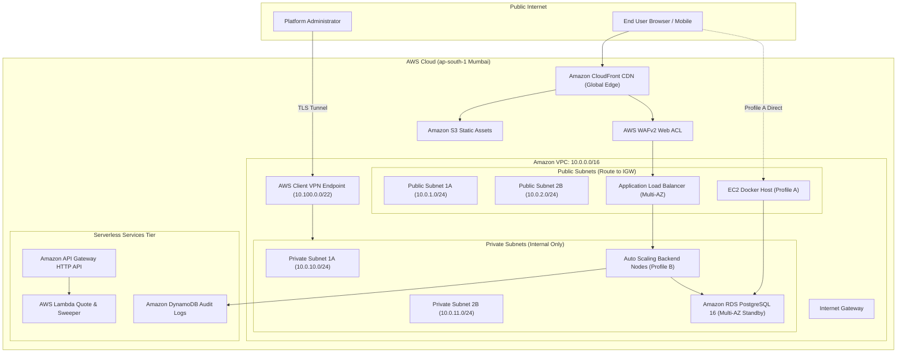

# BorrowBuy – Virtual Private Cloud (VPC) & Network Architecture Design

**Target Region:** `ap-south-1` (Asia Pacific – Mumbai)  
**VPC CIDR:** `10.0.0.0/16` (65,536 private IPv4 addresses)  
**Availability Zones:** `ap-south-1a` & `ap-south-1b`

---

## 1. Network Topology Diagram

---

## 2. Subnet Allocation & CIDR Plan

| Subnet Name | AZ | CIDR Block | Usable IPs | Routing Target | Purpose |
|---|---|---|---|---|---|
| `public-subnet-1a` | `ap-south-1a` | `10.0.1.0/24` | 251 | Internet Gateway (`igw-xxxx`) | ALB Node A, Profile A EC2 Host |
| `public-subnet-1b` | `ap-south-1b` | `10.0.2.0/24` | 251 | Internet Gateway (`igw-xxxx`) | ALB Node B (Required for Multi-AZ) |
| `private-subnet-1a` | `ap-south-1a` | `10.0.10.0/24` | 251 | NAT Gateway (Profile B) / Local | Primary PostgreSQL RDS, ASG Node A |
| `private-subnet-1b` | `ap-south-1b` | `10.0.11.0/24` | 251 | NAT Gateway (Profile B) / Local | Secondary Standby RDS, ASG Node B |
| `vpn-clients-pool` | Overlay | `10.100.0.0/22` | 1,022 | Split Tunnel Association | Developer & Admin VPN Clients |

---

## 3. Security Groups Matrix & Traffic Rules

To enforce strict defense-in-depth, security groups are chained by ID rather than open CIDRs:

### 3.1 ALB Security Group (`borrowbuy-alb-sg`)
- **Inbound Rules:**
  - `HTTP (TCP 80)` from `0.0.0.0/0` (Redirects to HTTPS in production)
  - `HTTPS (TCP 443)` from `0.0.0.0/0` (Protected by WAFv2)
- **Outbound Rules:**
  - `TCP 5000` to `borrowbuy-app-sg` (Backend target group)

### 3.2 Backend Compute Security Group (`borrowbuy-app-sg`)
- **Inbound Rules:**
  - `TCP 5000` from `borrowbuy-alb-sg` only (Direct public access blocked in Profile B)
  - `SSH (TCP 22)` from `borrowbuy-vpn-sg` or bastion only
- **Outbound Rules:**
  - `PostgreSQL (TCP 5432)` to `borrowbuy-rds-sg`
  - `HTTPS (TCP 443)` to `0.0.0.0/0` (AWS APIs: S3, DynamoDB, SQS, CloudWatch)

### 3.3 Database Security Group (`borrowbuy-rds-sg`)
- **Inbound Rules:**
  - `TCP 5432` from `borrowbuy-app-sg` only
  - `TCP 5432` from `borrowbuy-vpn-sg` (Admin database management)
- **Outbound Rules:**
  - Deny all outbound traffic (Databases never initiate external connections)

---

## 4. Dual FinOps Profiles (Profile A vs Profile B)

### Profile A: Academic Demonstration (Low Cost / Free Tier)
- **NAT Gateways:** **0** (Disabled). Saves \$32.40/month.
- **ALB:** **0** (Single EC2 host with Elastic IP). Saves \$18.00/month.
- **Compute:** Single `t3.micro` host in `public-subnet-1a` running Docker Compose.
- **Monthly Infrastructure Cost:** **\$0.00 – \$1.50** (Eligible for AWS 12-Month Free Tier).

### Profile B: Enterprise Production (Multi-AZ High Availability)
- **NAT Gateways:** 1 (Single NAT across public subnets to allow private ASG instances outbound internet).
- **ALB:** Multi-AZ across `ap-south-1a` and `ap-south-1b`.
- **Compute:** Auto Scaling Group (1 to 3 instances) in private subnets with Target Tracking.
- **Database:** Managed Multi-AZ Amazon RDS PostgreSQL 16.
- **Monthly Infrastructure Cost:** ~**\$65.00 – \$95.00/month**.
