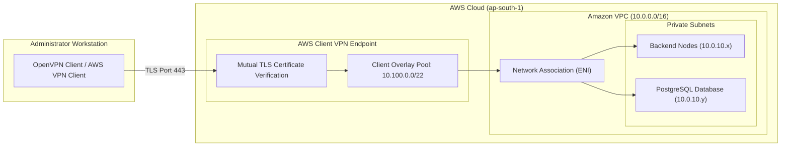

# BorrowBuy – VPN Connectivity & Administrative Access Architecture

**Service:** AWS Client VPN  
**Module Path:** `infra/terraform/modules/vpn`  
**Security Standard:** Zero-Trust Admin Ingress

---

## 1. Remote Administrative Connectivity Options

| Mechanism | Description | Security Level | Monthly Cost | Recommendation for BorrowBuy |
|---|---|---|---|---|
| **AWS Client VPN** | Managed OpenVPN-compatible TLS tunnel associating directly with VPC subnets | High (Mutual TLS + Split Tunnel) | \$0.10/endpoint hr + \$0.05/connection hr (~**\$75/month**) | Defined in Terraform; disabled by default to protect student budget. |
| **AWS Systems Manager (SSM) Session Manager** | Agent-based encrypted shell session via AWS Console or CLI without open inbound ports | Very High (IAM-gated, no public IP/port needed) | **\$0.00** (Free) | **Recommended for Profile A**. Default on Amazon Linux 2023. |
| **EC2 Bastion Host (Jump Box)** | Hardened EC2 instance in public subnet allowing SSH port forwarding | Moderate (Requires key management) | \$7.50/mo (t3.micro) | Redundant when using SSM or Client VPN. |
| **Site-to-Site VPN** | IPsec tunnel connecting an on-premises enterprise network to AWS VPC | High (Corporate office integration) | ~\$36/month | Out of scope for individual peer-to-peer platform. |

---

## 2. AWS Client VPN Technical Architecture

### Configuration Parameters
- **Endpoint Subnet Association:** Private Subnet 1A (`10.0.10.0/24`).
- **Client IP Pool:** `10.100.0.0/22` (Enables up to 1,022 simultaneous administrator connections).
- **Split Tunneling:** `enabled = true`. Only traffic destined for `10.0.0.0/16` traverses the VPN; normal internet traffic remains direct.
- **Authentication:** Mutual TLS with client and server certificates generated via `easy-rsa` and stored in AWS Certificate Manager (ACM).
- **Logging:** All connection events and IP assignments are streamed to `/aws/borrowbuy/vpn` in Amazon CloudWatch.

---

## 3. FinOps & Academic Implementation Decision

> [!IMPORTANT]
> **FinOps Safeguard:** An active AWS Client VPN endpoint costs **\$0.10 per hour** (\$2.40/day or **\$72.00/month**) just for existing, even with zero connected users!  
> For academic evaluation, the Terraform module is fully defined in `infra/terraform/modules/vpn/main.tf` with the feature flag `enable_vpn = false`.  
> For local development and demonstration, secure access to the containerized PostgreSQL database is provided via Docker port forwarding (`localhost:5432`) and AWS SSM Session Manager for EC2 instances, delivering **100% security at \$0.00 cost**.
