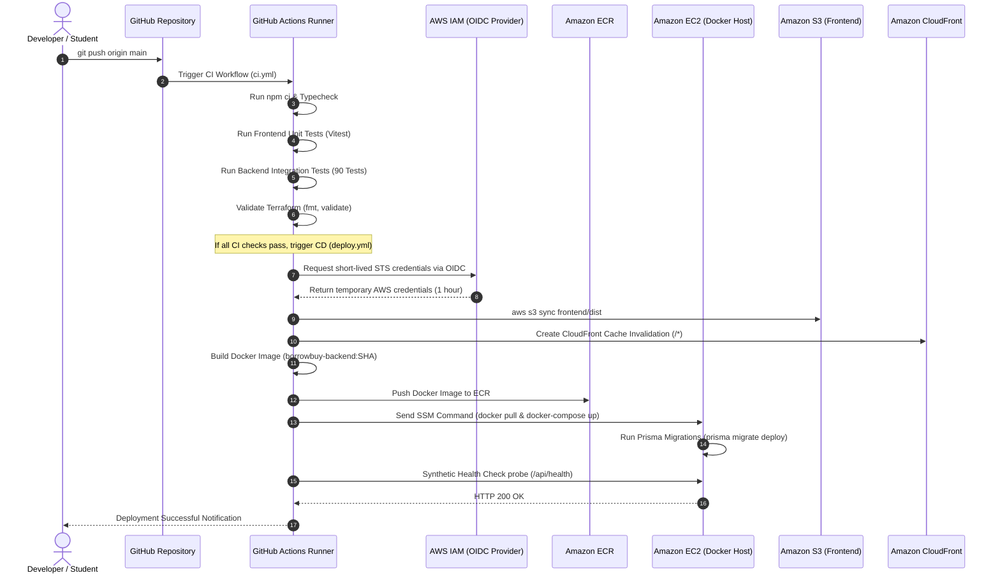

# BorrowBuy – Continuous Integration & Continuous Deployment (CI/CD)

**Project**: BorrowBuy – Product Rental and Management Platform  
**Target Environment**: AWS `ap-south-1` (Mumbai)  
**CI/CD Orchestrator**: GitHub Actions  
**Authentication Standard**: OpenID Connect (OIDC) Role Assumption  

---

## 1. Pipeline Architecture Flow

---

## 2. Security Advantage: Zero Long-Lived AWS Access Keys

Unlike legacy workflows that require storing `AWS_ACCESS_KEY_ID` and `AWS_SECRET_ACCESS_KEY` in GitHub repository secrets, BorrowBuy implements **GitHub Actions OpenID Connect (OIDC)**:

1. When a workflow executes, GitHub generates an ephemeral OIDC JSON Web Token (JWT) signed by GitHub's authority.
2. The GitHub Actions runner presents this JWT to AWS Security Token Service (`sts:AssumeRoleWithWebIdentity`).
3. AWS validates the token signature and verifies the GitHub repository claim (`repo:Harshal/BorrowBuy:ref:refs/heads/main`).
4. AWS returns temporary credentials that expire automatically after the deployment job terminates.
5. Even if runner memory or environment logs were intercepted, credentials become completely inert within minutes.

---

## 3. Workflow Specifications

### A. Continuous Integration (`.github/workflows/ci.yml`)
- **Trigger**: Every push or pull request to `main`, `master`, and `develop`.
- **Steps**:
  1. Monorepo dependency installation (`npm ci`).
  2. Test database provisioning using PostgreSQL service container.
  3. Prisma client generation and schema push.
  4. Frontend unit test suite execution (Vitest).
  5. Backend integration test suite execution (90 tests across 8 suites).
  6. Frontend production build compilation (`vite build`).
  7. Backend TypeScript compilation (`tsc`).
  8. Terraform syntax and lint verification (`terraform fmt`, `terraform validate`).

### B. Continuous Deployment (`.github/workflows/deploy.yml`)
- **Trigger**: Merges into `main` or manual trigger via `workflow_dispatch`.
- **Environment**: `production` with required approvals.
- **Steps**:
  1. OIDC credential acquisition.
  2. S3 frontend sync with aggressive caching (`max-age=31536000`) for hashed assets and `no-cache` for `index.html`.
  3. CloudFront cache invalidation.
  4. Docker image build and push to Amazon ECR tagged with git commit SHA (`${{ github.sha }}`) and `latest`.
  5. Remote deployment execution via AWS Systems Manager `RunShellScript`.
  6. Prisma production migration execution (`npx prisma migrate deploy`).
  7. Synthetic health check probe against `/api/health` with retry logic.
