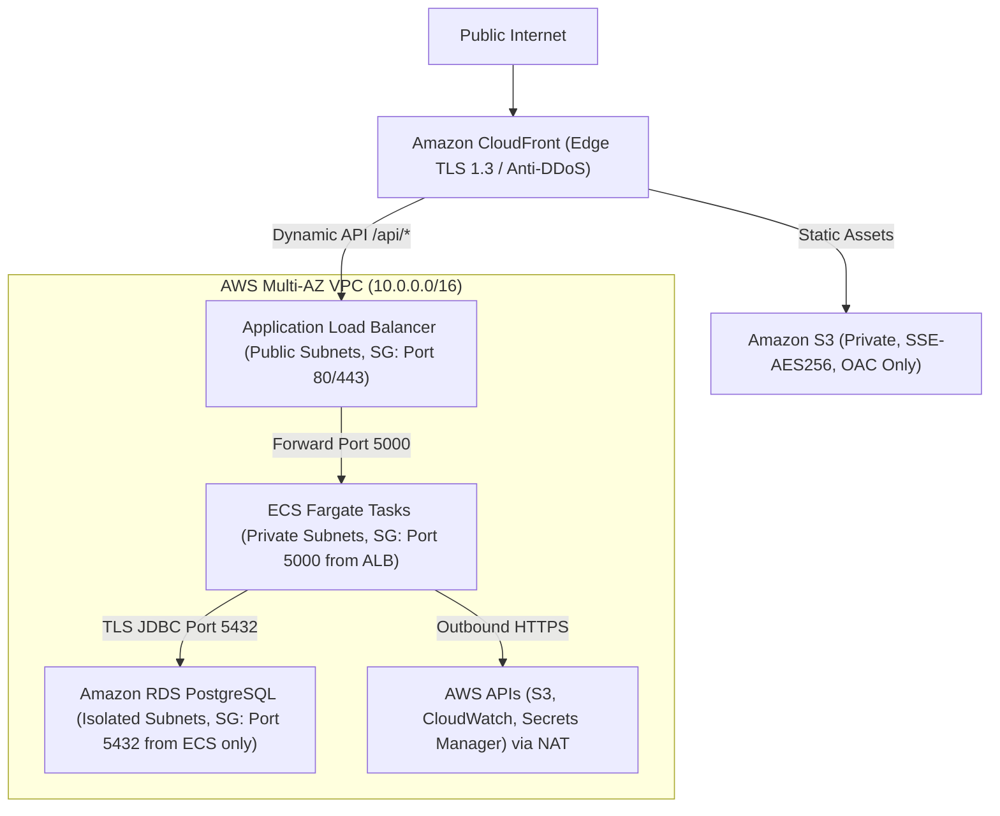

# BorrowBuy – Cloud Security, Compliance & Threat Model Specification

## 1. Security Architecture Principles

BorrowBuy implements a **Defense-in-Depth** and **Zero Trust** security posture across all cloud layers:
1. **Least Privilege Access**: Every IAM role, database user, and application identity is granted only the absolute minimum permissions required to perform its function.
2. **Strict Network Segmentation**: Public internet exposure is isolated to the edge CDN and Application Load Balancer; all compute, storage, and database tiers reside in non-routable private subnets.
3. **Data Protection Everywhere**: All traffic is encrypted in transit using TLS 1.2/1.3, and all data at rest is encrypted using AES-256 via AWS KMS and SSE-S3.
4. **Immutable Infrastructure**: Compute instances and container tasks run read-only filesystems where possible, and configuration drift is prevented by managing 100% of resources via Terraform.

---

## 2. Network Security Architecture & Isolation

### Security Group Ingress / Egress Matrix

| Security Group | Ingress Rules | Egress Rules | Security Objective |
| :--- | :--- | :--- | :--- |
| **`alb-sg`** | • `0.0.0.0/0`: Port 80 (Redirect HTTP $\to$ HTTPS) • `0.0.0.0/0`: Port 443 (HTTPS) | • `10.0.0.0/16`: Port 5000 (Target Group ECS tasks) | Public entrypoint; prevents traffic bypass directly to containers. |
| **`ecs-tasks-sg`** | • `alb-sg`: Port 5000 (HTTP traffic from ALB only) | • `10.0.0.0/16`: Port 5432 (RDS PostgreSQL) • `0.0.0.0/0`: Port 443 (Outbound AWS APIs via NAT) | Containers cannot receive arbitrary inbound connections from the internet. |
| **`rds-sg`** | • `ecs-tasks-sg`: Port 5432 (PostgreSQL only) | • None (Isolated / `127.0.0.1/32`) | Complete database isolation; zero external routability. |

---

## 3. Identity and Access Management (IAM) Least Privilege

### 3.1 ECS Task Execution Role (`ecs-execution-role`)
- **Assumed By**: `ecs-tasks.amazonaws.com`
- **Managed Policy**: `AmazonECSTaskExecutionRolePolicy`
- **Permissions**:
  - Pull container images from Amazon ECR.
  - Create and push log streams to CloudWatch Log Group `/ecs/borrowbuy-*`.
  - Fetch database credentials from AWS Secrets Manager.

### 3.2 ECS Application Task Role (`ecs-task-role`)
- **Assumed By**: Running containers at runtime
- **Scoped Permissions**:
  - `s3:PutObject`, `s3:GetObject`, `s3:DeleteObject` scoped strictly to `arn:aws:s3:::borrowbuy-*-assets/*`.
  - `s3:ListBucket` scoped strictly to `arn:aws:s3:::borrowbuy-*-assets`.
  - Explicitly **no permissions** to manage S3 bucket policies, IAM configurations, or VPC settings.

---

## 4. Secrets Management & Data Encryption

### 4.1 Secrets Management
- Database connection strings, master passwords, and JWT signing keys are stored exclusively in **AWS Secrets Manager** (`borrowbuy-dev-db-credentials-v2`).
- Secrets are injected into container environments as encrypted environment variables during task instantiation.
- **Zero hardcoded credentials**: The codebase contains only `.env.example` templates; `.env` is permanently excluded via `.gitignore`.

### 4.2 Encryption at Rest
- **PostgreSQL Database**: Encrypted at rest using AWS managed KMS key (`aws/rds`) with AES-256 bit encryption across storage, automated backups, and read replicas.
- **S3 Bucket**: Enforced server-side encryption via SSE-S3 (`AES256`).
- **CloudWatch Logs**: Encrypted using default AWS KMS managed keys.

### 4.3 Encryption in Transit
- **CloudFront to Client**: Enforced HTTPS redirect; TLS 1.2 minimum protocol (`TLSv1.2_2021` cipher suite).
- **Client to ALB**: SSL certificate managed via AWS Certificate Manager (ACM).
- **Backend to RDS**: PostgreSQL connection string enforces `sslmode=require`, and the custom parameter group sets `rds.force_ssl = 1`. Unencrypted database connections are rejected at the protocol level.

---

## 5. STRIDE Threat Modeling Analysis

| Threat Category (STRIDE) | Identified Threat Vector | Mitigating Control Implemented in BorrowBuy |
| :--- | :--- | :--- |
| **S - Spoofing** | Attacker impersonates an equipment owner to approve pickups or steal security deposits. | • Cryptographic single-use QR tokens (`PK-...` and `RT-...`). • BCrypt password hashing (12 salt rounds). • JWT signature validation with role-based middleware (`requireRole('OWNER')`). |
| **T - Tampering** | Renter tampers with rental price, duration, or dates in API payload to rent for free. | • Server-side Zod validation (`createBookingSchema`). • Server-side duration and pricing recalculation (`dailyPrice * days + deposit`). Client values are ignored. |
| **R - Repudiation** | User denies having picked up or returned damaged equipment. | • Audit logging of pickup/return timestamps in database. • Pre/post condition photo upload with immutable S3 object keys. • Single-use token invalidation upon redemption. |
| **I - Information Disclosure** | Competitor dumps all customer booking records, phone numbers, or passwords. | • PostgreSQL database isolated in private subnets with no public IP. • Passwords hashed with bcrypt and stripped from JSON response serializers. • S3 Block Public Access enabled across all 4 access dimensions. |
| **D - Denial of Service** | Malicious bot spams checkout to lock up gear and cause double-booking errors. | • Database-level pessimistic row lock (`SELECT ... FOR UPDATE`). • 15-minute temporary hold timeout sweeper. • CloudFront and ALB AWS Shield Standard DDoS protection. |
| **E - Elevation of Privilege** | Standard customer performs admin dispute arbitration or suspends users. | • Role-based access control guard `requireRole('ADMIN')` checked on every administrative endpoint. • Admin routes mounted under separate protected prefix (`/api/admin`). |

---

## 6. Incident Response & Operational Runbook

### Severity 1: Critical Incident (Database Outage or Data Breach)
1. **Identification**: CloudWatch Alarm triggers for `rds-storage-low` or ALB 5XX rate spikes.
2. **Containment**:
   - Immediately invoke emergency security group isolation if abnormal traffic detected.
   - Rotate database master credentials in AWS Secrets Manager.
3. **Eradication & Recovery**:
   - Restore database from latest automated point-in-time snapshot (PITR).
   - Rollback ECS task definition revision to previous known-healthy task definition.
4. **Post-Mortem**: Document root cause, timeline, impact, and preventive action items in `docs/incidents/`.
