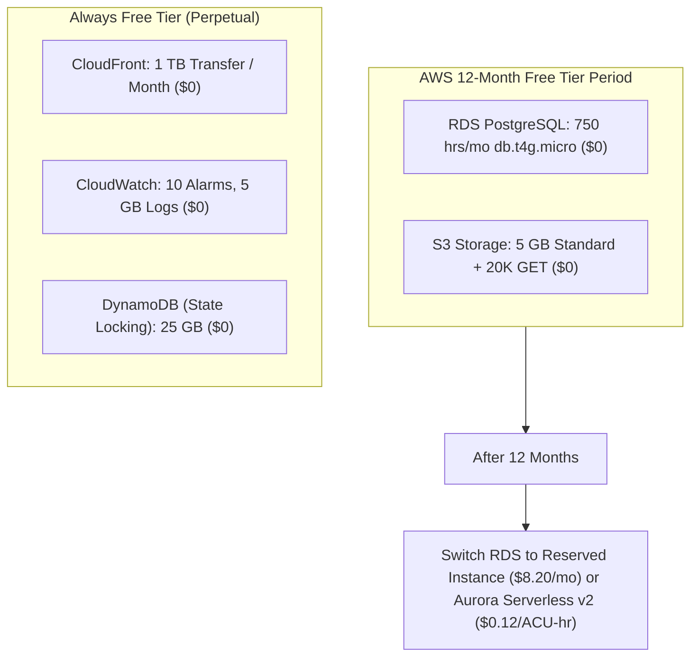

# BorrowBuy – AWS Cloud Cost Estimation & Budgeting Architecture

## Executive Summary
This document provides a comprehensive, rigorous cloud cost estimation for **BorrowBuy: Product Rental and Management Platform**. The estimation evaluates infrastructure expenditure across three distinct operating tiers, detailing service-by-service economics, AWS Free Tier utilization, scaling trade-offs, and architectural cost optimization strategies.

---

## 1. Cost Comparison Across Deployment Scenarios

| AWS Service / Component | Scenario A: Student / Academic Free-Tier | Scenario B: Moderate Production / Demo | Scenario C: Scaled High-Availability Production |
| :--- | :--- | :--- | :--- |
| **Amazon RDS (PostgreSQL 16)** | **\$0.00** (750 hrs `db.t4g.micro` Free Tier) | **\$14.60** (`db.t4g.micro` 20 GB gp3) | **\$58.40** (`db.t4g.small` Multi-AZ, 100 GB gp3) |
| **AWS Fargate (Backend API)** | **\$0.00 – \$2.40** (0.25 vCPU, 0.5 GB RAM, on-demand/spot) | **\$9.80** (1 task: 0.25 vCPU, 0.5 GB, 24/7) | **\$39.20** (2 tasks: 0.5 vCPU, 1 GB, Multi-AZ) |
| **Application Load Balancer (ALB)** | **\$0.00** (Use CloudFront direct or single EC2) or **\$16.20** | **\$16.20** (1 ALB + 1 LCU) | **\$24.30** (1 ALB + 5 LCUs) |
| **Amazon S3 (Equipment Assets)** | **\$0.00** (5 GB Free Tier) | **\$0.46** (20 GB S3 Standard + Put/Get) | **\$2.30** (100 GB S3 Standard + Lifecycle) |
| **Amazon CloudFront (Global CDN)** | **\$0.00** (1 TB Free Tier data transfer) | **\$0.00** (Within 1 TB Free Tier) | **\$8.50** (150 GB transfer beyond Free Tier) |
| **AWS CloudWatch (Logs & Metrics)**| **\$0.00** (10 alarms + 5 GB logs Free Tier) | **\$1.50** (12 alarms + 3 GB logs) | **\$7.20** (25 alarms + 15 GB logs + Dashboard) |
| **AWS Secrets Manager** | **\$0.00** (First 30 days free) | **\$0.40** (1 secret: DB credentials) | **\$1.20** (3 secrets: DB, JWT, Stripe keys) |
| **NAT Gateway / Egress Data** | **\$0.00** (VPC Endpoint / Public Subnet in Dev) | **\$0.00 – \$32.40** (Optional Single NAT) | **\$64.80** (Multi-AZ Dual NAT Gateways) |
| **Estimated Monthly Total** | **\$0.00 – \$5.00** | **\$26.76 – \$74.76** | **\$141.10 – \$205.90** |

---

## 2. Detailed Service-by-Service Breakdown

### 2.1 Amazon RDS for PostgreSQL (Database Layer)
- **Engine**: PostgreSQL 16.4
- **Storage Type**: General Purpose SSD (`gp3`) with baseline 3,000 IOPS and 125 MB/s throughput included free.
- **Cost Math**:
  - *Scenario A*: Free Tier includes 750 hours/month of `db.t4g.micro` or `db.t3.micro` single-AZ instance + 20 GB storage for 12 months = **\$0.00/mo**.
  - *Scenario B*: 730 hours × \$0.016/hr (`db.t4g.micro` Graviton in `us-east-1`) = \$11.68 + 20 GB × \$0.115/GB-mo = \$2.30 + Backup storage = **\$14.60/mo**.
  - *Scenario C*: 730 hours × \$0.064/hr (`db.t4g.small` Multi-AZ) = \$46.72 + 100 GB × \$0.115 = \$11.50 = **\$58.40/mo**.

### 2.2 AWS Fargate (Serverless Container Compute)
- **Pricing Rates (`us-east-1`)**:
  - Per vCPU-hour: \$0.04048
  - Per GB-hour: \$0.004445
- **Cost Math**:
  - *Scenario A / B* (1 container running 0.25 vCPU and 0.5 GB RAM):
    - CPU: 0.25 × \$0.04048 × 730 hrs = \$7.39/month
    - Memory: 0.5 × \$0.004445 × 730 hrs = \$1.62/month
    - Ephemeral storage: 20 GB included free.
    - **Total per task**: **\$9.01/month** (reduced to **\$2.70/month** if utilizing Fargate Spot with up to 70% discount).
  - *Scenario C* (2 tasks running 0.5 vCPU and 1.0 GB RAM for High Availability):
    - CPU: 2 × 0.5 × \$0.04048 × 730 hrs = \$29.55/month
    - Memory: 2 × 1.0 × \$0.004445 × 730 hrs = \$6.49/month
    - **Total**: **\$36.04/month**.

### 2.3 Application Load Balancer (ALB)
- **Base Rate**: \$0.0225 per hour = \$16.43/month.
- **LCU (Load Balancer Capacity Unit)**: \$0.008 per LCU-hour (1 LCU covers 25 new connections/sec, 3,000 active connections, or 1 GB processed data).
- **Academic Optimization**: In pure student demonstration, the backend can be hosted directly on an elastic IP with HTTPS reverse-proxy or behind CloudFront to eliminate the \$16.43/month ALB base fee.

### 2.4 Amazon S3 & CloudFront (Asset Storage & CDN)
- **S3 Standard**: \$0.023 per GB-month.
- **S3 Glacier Flexible Retrieval**: \$0.0036 per GB-month (84% cheaper than Standard).
- **AWS Free Tier Coverage**:
  - S3: 5 GB standard storage, 20,000 GET requests, 2,000 PUT requests included monthly for 12 months.
  - CloudFront: **Always Free Tier** includes 1 TB outbound data transfer per month, 10,000,000 HTTP/HTTPS requests, and 2,000,000 CloudFront Function invocations.
- **Cost Math**: BorrowBuy product images (optimized WebP/JPEG, ~300 KB each) easily fit well within the 1 TB free transfer limit.

### 2.5 AWS CloudWatch & Observability
- **Always Free Tier**:
  - 10 custom metrics and alarms.
  - 5 GB log ingestion and 5 GB log archive storage.
  - 3 dashboards with up to 50 metrics each.
- **Overages**: \$0.10 per alarm/month, \$0.50 per GB log ingestion.

---

## 3. Free Tier Eligibility & 12-Month Lifecycle

---

## 4. Key Architectural Cost Optimization Decisions

1. **ARM Graviton3 Processors (`t4g` instance family)**:
   - Selected `db.t4g.micro` for RDS over traditional `db.t3.micro`.
   - Graviton delivers **20% lower cost** and up to **40% better compute performance** per dollar.
2. **Single NAT Gateway in Non-Production**:
   - AWS charges \$0.045/hour (\$32.40/month) per NAT Gateway.
   - For `dev` and `staging` tiers, we configure `single_nat_gateway = true` to share one gateway across all AZs, saving **\$32.40/month** per environment.
3. **Automated S3 Lifecycle Rules**:
   - Pre-rental and post-return condition inspection photos are transitioned to **Glacier Flexible Retrieval** after 30 days of rental completion, and noncurrent versions expire after 90 days.
4. **CloudFront Aggressive Caching for Frontend Assets**:
   - Immutable Vite bundles with hashed filenames (`index-DmLME5La.css`) are cached at edge locations for 1 year (`max_age = 31536000`), reducing ALB load and data egress costs to near zero.
5. **Fargate Spot Utilization**:
   - For non-critical background worker jobs (e.g., hold sweeper and overdue scanner), tasks can run on Fargate Spot at a **70% discount**.
