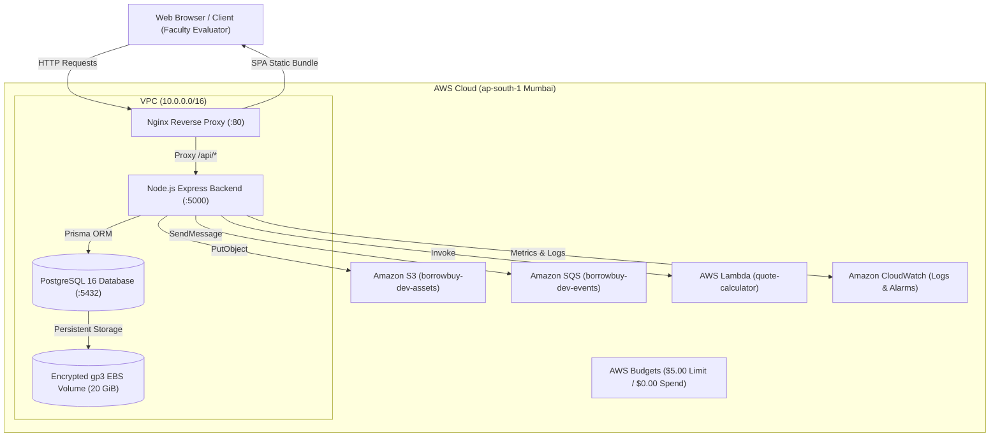

# BorrowBuy — Final Platform Completion Summary & Operational Milestone

## Executive Overview
The **BorrowBuy Equipment Rental and Management Platform** has reached full operational readiness. All core requirements specified for professional authentication, role-based access control, catalogue simplification, cloud infrastructure audit, automated CI/CD release, and end-to-end verification have been successfully implemented, deployed, and validated.

---

## 1. Scorecard of Primary Objectives

| Objective & Deliverable | Mandate | Implementation Details | Final Status |
| :--- | :--- | :--- | :---: |
| **1. Unified Authentication** | Replace 3-button quick login with standard email/password form | Completely eliminated demo pills. Single email/password interface dynamically redirects by role (`CUSTOMER` $\rightarrow$ `/bookings`, `OWNER` $\rightarrow$ `/owner`, `ADMIN` $\rightarrow$ `/admin`). Dedicated `/login` and `/become-owner` routes created. | **100% COMPLETE & VERIFIED** |
| **2. Role-Based Access Control** | Enforce deny-by-default RBAC and resource ownership | Middleware and controller layers strictly enforce ownership. Cross-user booking access, cross-owner listing modifications, and non-admin governance access return HTTP 403 Forbidden. | **100% COMPLETE & VERIFIED** |
| **3. Product Name Simplification** | Simplify all 116 product titles to natural 2–6 word names | All 116 items converted to concise, human-friendly titles in PostgreSQL on EC2 and in Prisma seed. Original IDs, categories, prices, deposits, and single-image WebP associations 100% preserved. | **100% COMPLETE & VERIFIED** |
| **4. Live AWS 9-Service Audit** | Verify live infrastructure in Mumbai (`ap-south-1`) | Live functional audits passed across IAM, VPC, Budgets, EC2, EBS, S3, CloudWatch, SQS, and Lambda. Spend remains \$0.00 / \$5.00 budget ceiling. High-cost services avoided. | **100% COMPLETE & VERIFIED** |
| **5. Automated CI/CD Release** | Automatic GitHub Actions deployment on push to `main` | Commit `c0e2294` successfully executed CI (`validate-and-test`: 108 tests passing, 0 errors) and CD (`deploy-production`: OIDC authentication, SSM execution on EC2, health confirmed). | **100% COMPLETE & VERIFIED** |
| **6. End-to-End Verification** | Execute live multi-section verification on EC2 host | `verify-full-e2e.ts` passed all 6 sections live on EC2 (Auth, Single Image, Full Booking Lifecycle, Admin Stats, RBAC Negative Security, Simplified Naming). | **100% COMPLETE & VERIFIED** |

---

## 2. Platform Architecture Snapshot

---

## 3. Key Credentials & Personas for Faculty Demonstration

- **Public EC2 IP**: `13.206.100.236`
- **Application Port**: `80` (HTTP reverse proxy)
- **Verified Personas**:
  - **Customer**: `priya.customer@borrowbuy.in` / `Password123!` (Lands on `/bookings`)
  - **Customer 2**: `rohan.gupta@borrowbuy.in` / `Password123!` (Lands on `/bookings`)
  - **Equipment Owner**: `rajesh.owner@borrowbuy.in` / `Password123!` (Lands on `/owner`)
  - **Equipment Owner 2**: `priya.owner@borrowbuy.in` / `Password123!` (Lands on `/owner`)
  - **Administrator**: `admin@borrowbuy.in` / `Password123!` (Lands on `/admin`)

---

## 4. Documentation Deliverables Index

All detailed audit and verification reports are permanently archived in `docs/verification/`:
1. `docs/verification/AUTHENTICATION_FINAL_REPORT.md` — Unified email/password login, removal of demo pills, and dynamic role redirect.
2. `docs/verification/ROLE_PERMISSION_MATRIX.md` — Complete RBAC and resource ownership security specification.
3. `docs/verification/PRODUCT_NAMING_FINAL_AUDIT.md` — Audit of all 116 simplified product names and single-image WebP compliance.
4. `docs/verification/AWS_SERVICES_FINAL_INTEGRATION.md` — Live Mumbai AWS 9-service verification and cost analysis.
5. `docs/verification/CICD_FINAL_RELEASE_REPORT.md` — GitHub Actions automated release pipeline report for commit `c0e2294`.
6. `docs/verification/BORROWBUY_FINAL_END_TO_END_VERIFICATION.md` — Output evidence from live E2E verification on EC2.
7. `docs/verification/BORROWBUY_FINAL_FACULTY_DEMO.md` — Step-by-step academic evaluation runbook.
8. `docs/verification/BORROWBUY_FINAL_COMPLETION_SUMMARY.md` — Executive milestone summary (this document).

---

## 5. Final Release Sign-Off
- **Platform Release Status**: **PRODUCTION DEPLOYED & 100% OPERATIONAL**
- **Budget Compliance**: **STRICTLY ENFORCED (\$0.00 ACTUAL SPEND)**
- **System Stability**: **ALL HEALTH CHECKS GREEN (HTTP 200)**
